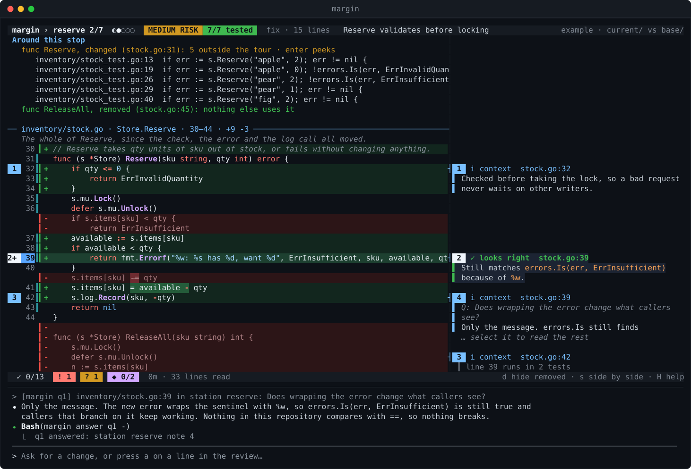

# margin

**Yet another code review tool.** Yes. The one that makes sure you actually read the change, shows
which tests run each line, and lets you break a line in place, with vim keys, to see whether any of
them notice. See [the project page](https://antas.cz/margin/).

margin reviews git changes with a coding agent beside you. The agent reads the change first, lays
out a route through it in reading order and writes a note on every change: what it does, why it is
there and whether it looks right. You walk the route, ask about any line, comment, and decide, while
the agent answers in the review as you go.



It comes in two front ends over the same reviews, with the same features. Pick the one that fits how
you work, or use both: a review started in one goes on in the other.

| | [**margin-tui**](docs/tui.md) | [**margin-gui**](docs/gui.md) |
| --- | --- | --- |
| What it is | the review in your terminal, the agent in a tmux pane beside it | a desktop app: the review in a window, the agent in a terminal inside it |
| Start a review | `margin-tui pick` lists your repositories, worktrees, branches, commits and pull requests; or `margin-tui`, `margin-tui feature-x`, `margin-tui --pr 123` in a repository | pick a repository, worktree and branch, commit or pull request in the sidebar, or ctrl+k |
| Using it | keys; the mouse picks lines, blocks, links and stops | buttons, and the same keys |
| Needs | git, tmux, an agent CLI | git, an agent CLI, a WebKit webview (built into macOS; WebKitGTK on Linux) |
| Install | `go install github.com/redrick/margin/cmd/margin-tui@latest` | `go install github.com/redrick/margin/cmd/margin-gui@latest`, then `margin-gui --install` |
| Read the manual | [docs/tui.md](docs/tui.md) | [docs/gui.md](docs/gui.md) |

> Status: early, but the whole loop works.

## Install

Download a binary for your system from the [releases](https://github.com/redrick/margin/releases),
or build with Go 1.21 or newer (Go fetches the toolchain the module needs by itself):

```sh
go install github.com/redrick/margin/cmd/margin-tui@latest     # the terminal viewer
go install github.com/redrick/margin/cmd/margin-gui@latest     # the desktop app
margin-gui --install                                           # put the desktop app in your launcher
```

`go install` puts the binaries in `$(go env GOPATH)/bin`; make sure that directory is on your `PATH`.
margin-gui needs a C compiler and, on Linux, the GTK 4 and WebKitGTK 6 development packages to
build; [docs/gui.md](docs/gui.md#install) lists them per distribution, and the `-tags gtk3` build
for systems with only WebKitGTK 4.1.

Each binary is complete on its own. Neither needs the other, nor a separate `margin` command: the
agent they start gets a `margin` link to the binary that started it.

## The agent

margin does not review anything itself; it gives an agent the change, the format and the commands,
and shows you what the agent writes. Any agent CLI that takes an initial prompt and can run shell
commands works:

| Agent | Setting |
| --- | --- |
| [Claude Code](https://docs.claude.com/en/docs/claude-code) | `claude` (the default) |
| [Codex CLI](https://github.com/openai/codex) | `codex` |
| [Gemini CLI](https://github.com/google-gemini/gemini-cli) | `gemini -i {prompt}` |
| [OpenCode](https://opencode.ai) | `opencode --prompt {prompt}` |
| anything else | its command; the instructions are the last argument, or replace `{prompt}` |

Set it with `margin-tui config set agent codex` or in margin-gui's settings.

The agent learns the rest from margin: `margin brief` gives it the task, `margin agent-help` the
full instructions and the review file format. Your questions reach it as `[margin qN] …`, your
comments as `[margin comments] …`, the problems you agreed with and the stops you said need changes as `[margin fix] …`,
and it answers through `margin answer`, `margin resolve` and the
comments note beside the review.

### The skill

The [margin skill](skills/margin/SKILL.md) teaches an agent margin even in a session margin did not
start, so you can ask your agent for "a margin review of this branch" and it prepares the review
for you to open. Install it for Claude Code or Codex with either binary, or from margin-gui's
settings:

```sh
margin-tui skill install claude     # ~/.claude/skills/margin/SKILL.md
margin-tui skill install codex      # ~/.codex/skills/margin/SKILL.md
margin-tui skill status
```

Claude Code can also install it as a plugin from this repository:

```text
/plugin marketplace add redrick/margin
/plugin install margin@margin
```

## Settings

Both front ends share `~/.config/margin/config.yaml` (`$XDG_CONFIG_HOME/margin/config.yaml`):

```yaml
reviews: repo        # where reviews are kept: repo, state, or a directory
agent: claude        # the agent command
agent_note: ""       # a line added to the agent's instructions
```

- **`reviews: repo`** (the default) keeps reviews in `.margin/reviews/` inside the repository,
  shared by all its worktrees. That folder holds a `.gitignore` of its own, so reviews never end up
  in a commit.
- **`reviews: state`** keeps them in `~/.local/state/margin`, outside every repository.
- **A directory** keeps them wherever you like, for example in a notes vault:
  `~/notes/{project}/topics/{topic}`. `{project}` is the repository's name (or its
  `ai.memoryProject` git setting), `{topic}` the branch, `{repo}` a unique folder per repository.
  A path with `{project}` or `{topic}` counts as a notes folder: review files are named `margin-…`
  and start with frontmatter, and `agent_note` can tell the agent how to file them, for example
  "List the review in the index of {project}."

`margin-tui config` shows the settings, `margin-tui config help` explains them,
`margin-tui config set reviews state` changes one. `$MARGIN_DIR` and `$MARGIN_AGENT` override the
file for one run.

Next to each review file margin keeps the reader's state (`.review.state.yaml`), the agent's answers
to your comments (`.comments.md`) and test coverage (`.review.coverage.json`).

## Repository settings

A repository can keep review rules for everyone under `.margin/`: `ignore` lists generated files
that need no stop, and `instructions` tells the agent what reviewers of this repository always
check. margin reads both from the commit it compares against, so a change cannot rewrite the rules
it is reviewed by. See [Repository settings](docs/tui.md#repository-settings).

## Safety

margin is meant for reading code you did not write, so it treats the repository as untrusted. On
its own it runs nothing from it; git is used through read-only plumbing, and the only files margin
writes are its own. The exceptions are yours to trigger: margin-gui's *Fetch and review* on a pull
request runs `git fetch origin pull/N/head`; running tests runs only the test command you set up in
your own settings, never one from the repository; and trying a change writes your edit of a line
into the file while its tests run, then puts the line back. `--pr` and the pull request list read
through `gh` and never post. Terminal
escape sequences and bidi controls are stripped before anything is shown. Commit messages, pull
request descriptions and `.margin/instructions` reach the agent marked as written by others. What
the agent does is up to the agent and its permissions; that includes running your tests for
coverage. More in [docs/tui.md](docs/tui.md#safety).

## Development

```text
cmd/margin-tui     the terminal viewer and the margin command line
cmd/margin-gui     the desktop app (Wails v3); its page is plain HTML, CSS and JavaScript in assets/
internal/cli       the command line both binaries share, including the commands the agent runs
internal/…         reviews, diffs, anchors, coverage, the terminal viewer (tui), settings (config)
skills/margin      the agent skill, embedded in both binaries
```

```sh
go test ./...                  # needs the margin-gui build dependencies, see docs/gui.md
go test ./internal/...         # everything but the desktop app
go build ./cmd/margin-tui
go build ./cmd/margin-gui      # -tags gtk3 with WebKitGTK 4.1; GOFLAGS=-tags=gtk3 for go test/vet too
```

One test builds and runs a small Go module to check the coverage script end to end (`-short` skips
it). A `v*` tag builds release binaries for Linux and macOS through GitHub Actions.

## Roadmap

- Light theme
- Word-level highlighting inside changed lines
- Faster loading of large diffs (`git cat-file --batch`)
- Picking up files that start changing while a review is open
- `margin html` export

## License

MIT, see [LICENSE](LICENSE).
